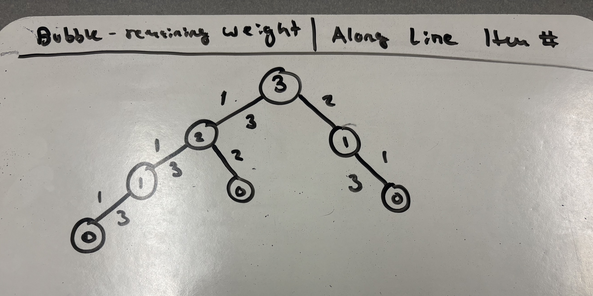

# Lab 07: The Integer-Valued Knapsack Problem

**Name:** Joshua Mehler

## Introduction
In this lab, you will explore different variations of the Knapsack problem and design a dynamic programming solution for one of them. You may work in small groups or individually, but everyone should write up their own answers to the questions below. 

Suppose we're going hiking. We have items $1, \ldots, n$ that we could pack in multiples with corresponding values $v_1, \ldots, v_n$ and weights $w_1, \ldots, w_n$. For example, we might have a water bottle (weight 1, value 2) and a sandwich (weight 2, value 5). Consider the following three problem variations:

1. Maximize value subject to capacity $W$, where you can pack at most one of each item.
2. Maximize value subject to capacity $W$, where you can pack a positive integer value of each item.
3. Minimize weight subject to minimum value $V$, where you can pack a positive integer value of each item.

---

## Part 1: Dynamic Programming Fundamentals

**Question:** Which of the three problem variations can be solved using the dynamic programming approaches we've studied in lecture? Explain your reasoning.

All three problems can be used solving dynamic programming. For all three problems there is a target Weight/Value that we are reaching for. In the sake of the first two problems, it is the weight of the maximum carrying capacity, and in the the third problem, it is the minimum value V given. 

## Part 2: The Naive Recursive Algorithm

Below is a naive recursive algorithm intended to solve one of the variations listed above.

```text
Function MaxValue(W):
    if W == 0:
        return 0
        
    max_val = 0
    for i from 1 to n:
        if w_i <= W:
            current_val = v_i + MaxValue(W - w_i)
            if current_val > max_val:
                max_val = current_val
                
    return max_val
```

**Question:** Which of the three problem variations (1, 2, or 3) does this algorithm solve? How do you know? Explain your reasoning.

This algorithm corresponds to problem 2. There is a maximum value which we are aiming for, and a weight W that we cannot exceed. As the recursive algorithm cycles, the for loop allows i from 1 to n for all recursions. Therefore, each value of v can be used multiple times, and there is no restriction on the number of each item you can pack. This seems most similar to problem 2.

## Part 3: Recursion Tree

Consider the following simple example:
* **Knapsack Capacity:** $W = 3$
* **Item 1:** Weight $w_1 = 1$, Value $v_1 = 2$
* **Item 2:** Weight $w_2 = 2$, Value $v_2 = 5$
* **Item 3:** Weight $w_3 = 1$, Value $v_3 = 3$

**Question:** Draw the full recursion tree for `MaxValue(3)` using the example above. Label the remaining capacity at each node and indicate which item is chosen along each branch.



## Part 4: Recurrence Relation

**Question:** Derive a mathematical recurrence relation for $OPT(W)$, the maximum value you can pack into a knapsack of capacity $W$, based on the naive recursive algorithm. Be sure to state your base case(s) and explain how you arrived at your formula.


$OPT(W)= \begin{cases}
0 && \text{if}\ W=0 \\
\text{max}_{1\leq i\leq n}\{v_i+OPT(W-w_i)\} && \text{if}\ W>0
\end{cases}$

We have $n$ items with weights $w_1,w_2,..w_n$ and values $v_1,v_2,...v_n$. From our naive algorithm, if W=0, then the max value returned is automatically zero. Otherwise, we carry out a recursive operation going down each branch of possible options, and the subtracting the weights of each object $i$ along the way. Then we find the maximum possible value produced by all possible branches. As we got down each branch, we do not remove the possibility of choosing any item, unless that item's weight exceeds that of the remaining weight.


## Part 5: Bottom-Up Dynamic Programming

Instead of using the slow recursive approach, we can build a table bottom-up. 

**Question:** Use your recurrence relation from Part 4 to fill in the following table for the example provided in Part 3 ($w_1=1, v_1=2$ and $w_2=2, v_2=5$). At each step, record the optimal value and the specific item chosen to achieve that value. 

| Capacity ($W$) | Optimal Value ($OPT$) | Item Chosen |
|:---:|:---|:---|
| **0** |0 |none |
| **1** |3 |Item 3 |
| **2** |6 |Item 3 x2 |
| **3** |9 |Item 3 x3 |
| **4** |12 |Item 3 x4 |
| **5** |15 |Item 3 x5 |
| **6** |18 |Item 3 x6 |

*Explain how you calculated the row for $W=6$*

We chose item 3 along each branch of our tree. Since item 3 has weight 1, we can chose it 6 times if W=6. Therefore, the optimal value is 6x3=18


## Part 6: Traceback

**Question:** Using the "Item Chosen" column from the table you completed in Part 5, trace back to find the exact quantities of each item to pack that maximize the value. What is the final optimal packing configuration for $W=6$ and the maximum value?

For every weight W, we chose item 3 as many times as possible. Item 3 has the greatest ratio of value to weight among all object, with Ratio=3. Additionally, Item 3's weight is 1, which divides all possible values of W. Therefore, if no matter what the remaining weight is, as long as its greater than 0, we can always choose 3. Since item 3 always has the best value to weight ratio, and we can always chose it if remaining weight>0, we should always chose it when given the opportunity. 